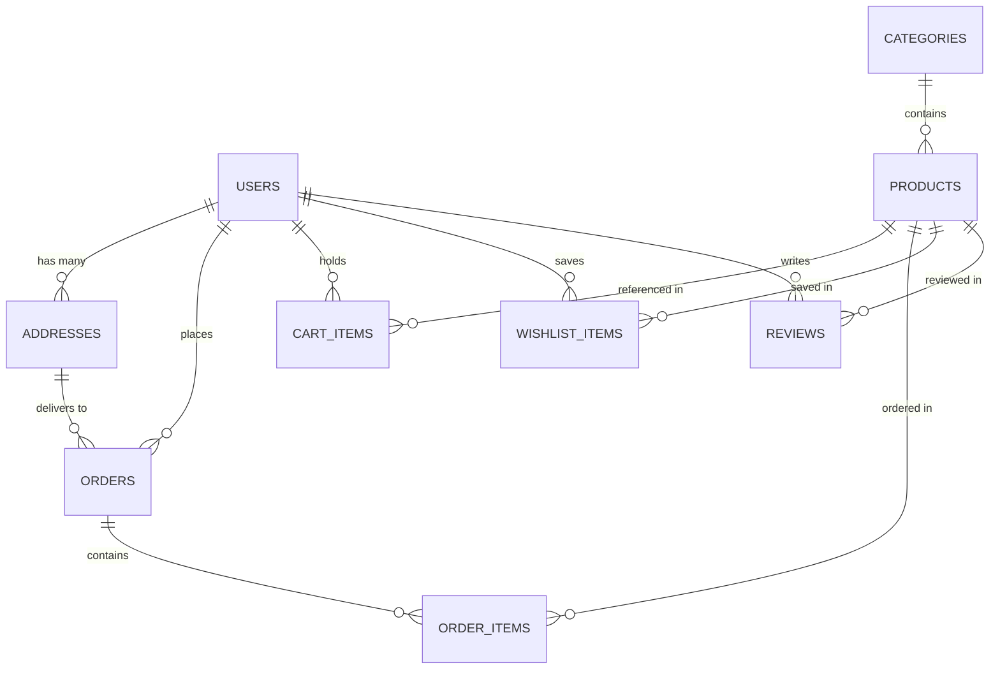

# MiniMart — Hyperlocal Express Grocery Delivery Platform

MiniMart is a full-stack hyperlocal grocery delivery application designed for 15-minute cold-chain fulfillment. Built with **FastAPI** (Python 3) and **React 19** (Vite + Tailwind CSS), it features an **Apple-inspired Liquid Glass UI Design System**, **INR (₹)** pricing, **Google Sign-In (OAuth 2.0)** + JWT email authentication, mobile-first responsive layouts with iPhone safe-area support, predictive search, live courier tracking, an itemized printable A4 invoice system, and a store manager dashboard.

---

## Live Development URLs

| Service / Interface | Local Address | Description |
| :--- | :--- | :--- |
| **Storefront App** | [http://localhost:5173](http://localhost:5173) | Customer grocery storefront (catalog, aisles, cart, checkout) |
| **Grocery Aisles** | [http://localhost:5173/categories](http://localhost:5173/categories) | Department browser with animated aisle filters |
| **Flash Deals** | [http://localhost:5173/deals](http://localhost:5173/deals) | Discounted items and promo coupons (`SAVE20`, `FREEDELIVERY`) |
| **Saved Wishlist** | [http://localhost:5173/wishlist](http://localhost:5173/wishlist) | Customer's saved favorite groceries |
| **Orders & Receipts** | [http://localhost:5173/orders](http://localhost:5173/orders) | Order history, statuses, and tracking links |
| **Live Tracking & PDF** | [http://localhost:5173/tracking/1](http://localhost:5173/tracking/1) | Real-time delivery simulation and printable order invoice |
| **Admin Dashboard** | [http://localhost:5173/admin](http://localhost:5173/admin) | Inventory manager, sales toggle, category/catalog editor, order status control |
| **Interactive API Docs** | [http://127.0.0.1:8000/docs](http://127.0.0.1:8000/docs) | FastAPI Swagger UI |
| **ReDoc API Reference** | [http://127.0.0.1:8000/redoc](http://127.0.0.1:8000/redoc) | Structured OpenAPI documentation |

---

## Demo Credentials

MiniMart auto-seeds demo accounts on startup (`backend/seed.py`) with 1-click quick login buttons in the sign-in modal:

| Role | Email | Password | Access Level |
| :--- | :--- | :--- | :--- |
| **Customer (Shopper)** | `customer@minimart.com` | `password123` | Browsing, cart, checkout, saved addresses, wishlist, reviews |
| **Store Manager (Admin)** | `admin@minimart.com` | `admin123` | Full catalog, category, stock, discount, and order fulfillment control |

---

## Core Features & Architecture

### 1. Authentication & Google Sign-In
- **Email & Password + JWT**: Register/login with bcrypt-hashed passwords, short-lived access tokens (`ACCESS_TOKEN_EXPIRE_MINUTES`), and refresh tokens (`POST /api/auth/refresh`).
- **Continue with Google**: Integrated Google Identity Services (`gsi/client` + [`GoogleSignInButton.jsx`](frontend/src/components/GoogleSignInButton.jsx)) positioned directly below the Sign In / Create Account submit action in [`AuthModal.jsx`](frontend/src/components/AuthModal.jsx).
- **Backend Token Verification & Schema Migration**: `POST /api/auth/google` verifies Google ID tokens via `google-auth` (`google.oauth2.id_token`) against `GOOGLE_CLIENT_ID`, links existing email accounts (`auth_provider`: `local` | `google` | `both`), creates passwordless Google users (`hashed_password` nullable), and runs `ensure_user_google_schema()` automatically on SQLite startup.

### 2. INR (₹) Pricing & Hyperlocal Checkout
- **Indian Rupee Formatting**: Centralized [`formatINR`](frontend/src/utils/currency.js) helper using `en-IN` number grouping (omitting `.00` on whole-rupee prices and keeping two decimals when paise apply).
- **Delivery Thresholds & Coupons**: Free standard delivery at **₹499+** (`₹29` standard fee below `₹499`, optional `₹49` express rush option in frontend checkout). Supports promo codes `SAVE20` (`20%` off subtotal) and `FREEDELIVERY` (`₹0` delivery).
- **Guest-to-User Cart Migration**: Guest basket items saved locally merge into the persistent database cart via `POST /api/cart/merge` upon sign-in.
- **Address Book Management**: Manage delivery addresses (`Home`, `Work`, custom street addresses) with instant ETA updates.

### 3. Responsive Mobile Layout & Liquid Glass Design System
- **Mobile-First Viewports & Safe Areas**: Configured with `viewport-fit=cover` in [`frontend/index.html`](frontend/index.html) and `env(safe-area-inset-top/bottom/left/right)` helpers (`.safe-top`, `.safe-bottom`, `.safe-x`, `.main-content-safe`) for notched/Dynamic Island devices.
- **Zero-Overflow Responsive Grids**: Equal-width 2-column `.product-grid` (`repeat(2, minmax(0, 1fr))`, `12px` mobile gap), square `aspect-ratio: 1 / 1; object-fit: cover` product thumbnails, fluid `clamp(...)` hero typography, compact header (`flex-shrink-0` brand lockup + flexible desktop search), and fixed mobile bottom bar clearance (`calc(80px + env(safe-area-inset-bottom))`). Verified across `320px`, `360px`, `375px`, `390px`, `414px`, `430px`, and `1280px` desktop widths.
- **Apple Liquid Glass System**: Layered `@layer components` glass panels (`.liquid-glass`, `.liquid-glass-card`, `.liquid-glass-dark`, `.liquid-bar`), floating ambient background mesh (`.liquid-mesh-bg`, `.liquid-orb`), Framer Motion spring animations, and Lucide React SVG icons.

### 4. Predictive Search, Courier Simulation & Printable Invoice
- **Debounced Live Search**: 180ms debounced `/api/products?search=...` dropdown with thumbnail previews and inline add-to-cart controls. Desktop search flexes seamlessly (`flex-1 min-w-[140px] max-w-[260px]`); mobile uses an expandable search bar toggle.
- **Courier Map Simulation & Chat**: Interactive delivery progress steps, scooter route visualization, ETA readout, and slide-over courier chat drawer.
- **Printable A4 Order Receipt**: `@media print` styles in [`frontend/src/index.css`](frontend/src/index.css) hide interactive UI chrome and format an A4 invoice with item breakdown and INR totals.

### 5. Store Manager Admin Dashboard
- **Inventory & Sales Control**: Increment/decrement product stock, toggle flash sales, add or edit catalog items and departments, and advance order statuses (`pending` -> `confirmed` -> `processing` -> `shipped` -> `delivered` / `cancelled`).

---

## Technology Stack

### Frontend
- **Framework**: React (`^19.3.1`) + React Router DOM (`^7.18.5`)
- **Build Tool**: Vite (`^8.3.5`) with `@vitejs/plugin-react`
- **Styling**: Tailwind CSS (`^3.4.17`, PostCSS + Autoprefixer) + custom Liquid Glass CSS layers
- **State & Data**: Zustand (`^5.0.16`) with `persist` middleware, Axios (`^1.21.0`), `@tanstack/react-query` (`^5.105.2`)
- **Forms & Validation**: React Hook Form (`^7.91.0`), Zod (`^4.6.7`), `@hookform/resolvers` (`^7.0.1`)
- **Motion, Icons & Feedback**: Framer Motion (`^14.9.0`), Lucide React (`^1.66.0`), React Hot Toast (`^2.6.1`)
- **Linting**: Oxlint (`^1.89.0`)

### Backend
- **Framework**: FastAPI (`0.115.5`) on Python 3.10+
- **ASGI Server**: Uvicorn (`0.32.1`)
- **Database & ORM**: SQLAlchemy (`2.0.36`), SQLite (`minimart.db`, created automatically on startup), Alembic (`1.14.0`)
- **Validation & Settings**: Pydantic (`2.10.2`), Pydantic Settings (`2.6.1`)
- **Auth & Security**: `python-jose[cryptography]` (`3.3.0`), `passlib[bcrypt]` (`1.7.4`), `google-auth` (`2.38.0`), `requests` (`2.32.3`)

---

## Repository Structure

```text
minimart/
├── backend/
│   ├── config.py             # Environment settings (DB URL, JWT, GOOGLE_CLIENT_ID)
│   ├── database.py           # SQLAlchemy engine, session helper & Google column migration
│   ├── models.py             # SQLAlchemy models (User, Product, Category, Order, etc.)
│   ├── schemas.py            # Pydantic request/response schemas
│   ├── auth.py               # Bcrypt, JWT, and Google ID token verification helpers
│   ├── seed.py               # Auto-seeded INR catalog and demo accounts
│   ├── main.py               # FastAPI app entry point, CORS, and lifespan bootstrap
│   ├── requirements.txt      # Pinned Python dependencies
│   └── routers/
│       ├── auth.py           # Register, login, Google OAuth, refresh, and profile routes
│       ├── products.py       # Catalog list, featured, deals, details, and admin CRUD
│       ├── categories.py     # Grocery aisles and department CRUD
│       ├── cart.py           # Persistent user cart & guest merge routes
│       ├── orders.py         # Checkout, coupons, order history, and status updates
│       ├── reviews.py        # Product reviews and ratings
│       └── user_data.py      # Saved addresses and wishlist routes
│
├── frontend/
│   ├── index.html            # HTML template (viewport-fit=cover + Google Identity script)
│   ├── vite.config.js        # Vite server & /api proxy to http://127.0.0.1:8000
│   ├── tailwind.config.js    # Tailwind CSS configuration
│   ├── package.json          # Frontend dependencies & scripts (dev, build, lint, preview)
│   └── src/
│       ├── main.jsx          # React entry point
│       ├── App.jsx           # Root shell, ambient mesh, routes, modals, bottom nav
│       ├── index.css         # @layer base/components, responsive utilities, print invoice
│       ├── api.js            # Axios client (VITE_API_URL / dev /api / Render prod URL)
│       ├── store.js          # Zustand store (auth, cart, wishlist, location, filters)
│       ├── utils/
│       │   ├── currency.js   # INR (₹) formatter and delivery threshold constants
│       │   └── effects.js    # Lightweight UI audio/tactile feedback helpers
│       ├── components/
│       │   ├── Header.jsx           # Sticky header, search overlay, user menu & cart pill
│       │   ├── BottomNav.jsx        # Fixed mobile bottom nav with safe-area padding
│       │   ├── AuthModal.jsx        # Email sign-in/register modal + quick demo login
│       │   ├── GoogleSignInButton.jsx # Google Identity Services OAuth button wrapper
│       │   ├── CartDrawer.jsx       # Slide-over basket with ₹499 free delivery meter
│       │   ├── CheckoutModal.jsx    # Delivery speed, payment method & coupon checkout
│       │   ├── LocationModal.jsx    # Saved & custom delivery address picker
│       │   ├── ProductCard.jsx      # 1:1 product card with wishlist & quantity stepper
│       │   └── ProductModal.jsx     # Product details, nutrition & verified reviews dialog
│       └── pages/
│           ├── HomePage.jsx          # Hero, aisles strip, flash deals & catalog grid
│           ├── CategoriesPage.jsx    # Department directory and filtered grid
│           ├── DealsPage.jsx         # Flash deals and promo code cards
│           ├── WishlistPage.jsx      # Customer saved favorites
│           ├── OrdersPage.jsx        # Customer order history & quick tracking links
│           ├── OrderTrackingPage.jsx # Live courier map, chat drawer & A4 tax invoice
│           └── AdminPage.jsx         # Store manager inventory, deals & orders console
│
└── README.md                 # Project documentation
```

---

## Database Schema Overview



- **User**: Supports role-based access (`customer` or `admin`), nullable `hashed_password` for Google users, unique `google_id`, `auth_provider` (`local`, `google`, `both`), and `avatar_url`.
- **Address**: Multiple saved shipping destinations per user with `is_default` flag.
- **Category**: Department slug, display title, theme gradient, description, and thumbnail.
- **Product**: SKU, current INR price, original INR price, unit, stock count, rating, active/featured/sale flags, and image URL.
- **Order**: Unique order number (`MM-YYYYMMDD-XXXXXX`), subtotal, delivery fee, promo discount, INR total, payment method, and status (`pending`, `confirmed`, `processing`, `shipped`, `delivered`, `cancelled`).
- **OrderItem**: Snapshot of unit price and quantity at time of purchase.

---

## Environment Configuration

### Backend (`backend/.env`, optional — defaults exist in `backend/config.py`)
| Variable | Default | Purpose |
| :--- | :--- | :--- |
| `DATABASE_URL` | `sqlite:///./minimart.db` | SQLAlchemy database connection string |
| `SECRET_KEY` | dev fallback key | Secret used to sign access & refresh JWTs (override in production) |
| `ALGORITHM` | `HS256` | JWT signing algorithm |
| `ACCESS_TOKEN_EXPIRE_MINUTES` | `60` | Access token lifetime |
| `REFRESH_TOKEN_EXPIRE_DAYS` | `7` | Refresh token lifetime |
| `GOOGLE_CLIENT_ID` | configured project client ID | OAuth client ID used to verify Google ID tokens |

> **Google OAuth Note**: Ensure your local and deployed origins (e.g., `http://localhost:5173`, `http://127.0.0.1:5173`, and your production frontend domain) are registered under **Authorized JavaScript origins** in Google Cloud Console for `GOOGLE_CLIENT_ID`.

### Frontend (`frontend/.env`, optional)
| Variable | Default Behavior | Purpose |
| :--- | :--- | :--- |
| `VITE_API_URL` | `/api` in Vite dev; Render API URL in prod build | Overrides the API base URL resolved in [`frontend/src/api.js`](frontend/src/api.js) |
| `VITE_GOOGLE_CLIENT_ID` | configured project client ID | Overrides the client ID passed to Google Identity Services |

---

## Getting Started

### Prerequisites
- **Python**: 3.10 or higher
- **Node.js**: 18.0 or higher (`npm`)

### Installation & Local Development

1. **Backend Setup**:
   ```bash
   cd backend
   pip install -r requirements.txt
   python -m uvicorn main:app --host 127.0.0.1 --port 8000 --reload
   ```
   *(Optional) Manually seed the SQLite database:*
   ```bash
   python seed.py
   ```

2. **Frontend Setup**:
   ```bash
   cd frontend
   npm install
   npm run dev
   ```
   Vite proxies `/api` requests automatically to `http://127.0.0.1:8000` (see `frontend/vite.config.js`).

3. **Lint & Production Build**:
   ```bash
   cd frontend
   npm run lint
   npm run build
   ```

---

## API Endpoints Reference

### System
- `GET /api/health` — API health check
- `POST /api/seed` — Trigger catalog and demo account seeding

### Authentication (`/api/auth`)
- `POST /api/auth/register` — Create new local customer account
- `POST /api/auth/login` — Email/password login returning JWT access & refresh tokens
- `POST /api/auth/google` — Verify Google Identity ID token and return JWT tokens
- `POST /api/auth/refresh` — Exchange refresh token for fresh JWT pair
- `GET /api/auth/me` — Fetch currently authenticated user profile
- `PUT /api/auth/me` — Update user profile details

### Products & Reviews (`/api/products`)
- `GET /api/products` — Catalog listing with pagination, category filter, search, sale/featured filter, and sort (`newest`, `price_asc`, `price_desc`, `rating`, `popular`)
- `GET /api/products/featured` — Featured grocery items
- `GET /api/products/deals` — Discounted flash-deal products
- `GET /api/products/{slug_or_id}` — Product details with aggregate rating
- `POST /api/products` — Admin create product
- `PUT /api/products/{product_id}` — Admin update product price, stock, or sale status
- `DELETE /api/products/{product_id}` — Admin remove product
- `GET /api/products/{product_id}/reviews` — List product reviews
- `POST /api/products/{product_id}/reviews` — Submit product review (authenticated)

### Grocery Aisles (`/api/categories`)
- `GET /api/categories` — List all active departments
- `GET /api/categories/{slug_or_id}` — Fetch single category details
- `POST /api/categories` — Admin create department
- `PUT /api/categories/{category_id}` — Admin update department
- `DELETE /api/categories/{category_id}` — Admin remove department

### Cart (`/api/cart`)
- `GET /api/cart` — Fetch authenticated user's persistent basket
- `POST /api/cart` — Add item or increment quantity
- `POST /api/cart/merge` — Merge guest basket items into user cart after login
- `PUT /api/cart/{item_id}` — Update basket item quantity
- `DELETE /api/cart/{item_id}` — Remove item from basket
- `DELETE /api/cart` — Clear entire basket

### Orders & Tracking (`/api/orders`)
- `POST /api/orders` — Checkout cart in INR, apply promo coupon (`SAVE20`, `FREEDELIVERY`), and deduct inventory
- `GET /api/orders` — Fetch orders (all orders for admin; customer's own orders otherwise)
- `GET /api/orders/{order_id}` — Order detail breakdown and itemized receipt
- `PATCH /api/orders/{order_id}/status` — Admin update order fulfillment status

### Customer Data (`/api/user`)
- `GET /api/user/addresses` — List saved delivery addresses
- `POST /api/user/addresses` — Add delivery address
- `PUT /api/user/addresses/{address_id}` — Update saved delivery address
- `DELETE /api/user/addresses/{address_id}` — Delete saved address
- `GET /api/user/wishlist` — List favorite items
- `POST /api/user/wishlist/{product_id}` — Toggle product in wishlist

---

## Attribution

Images sourced from Unsplash food collections; UI iconography provided by Lucide React.
