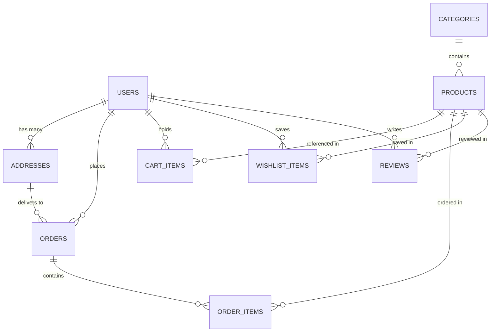

# MiniMart — Hyperlocal Express Grocery Delivery Platform

MiniMart is an end-to-end, full-stack hyperlocal grocery delivery application designed for 15-minute cold-chain delivery. Built with **FastAPI** (Python 3) and **React 19** (Vite + Tailwind CSS), it features an **Apple-inspired Liquid Glass UI Design System**, predictive live search, live courier tracking, an itemized printable PDF invoice system, and a store manager dashboard.

---

## Live Development URLs

| Service / Interface | Local Address | Description |
| :--- | :--- | :--- |
| **Storefront App** | [http://localhost:5173](http://localhost:5173) | Customer grocery storefront (catalog, aisles, cart, checkout) |
| **Grocery Aisles** | [http://localhost:5173/categories](http://localhost:5173/categories) | Department browser with animated spring aisle filters |
| **Flash Deals** | [http://localhost:5173/deals](http://localhost:5173/deals) | Discounted produce and promo coupons (`SAVE20`, `FREEDELIVERY`) |
| **Orders & Tracking** | [http://localhost:5173/orders](http://localhost:5173/orders) | Past deliveries, tracking links, and receipt archives |
| **Live Tracking & PDF** | [http://localhost:5173/tracking/5](http://localhost:5173/tracking/5) | Real-time delivery map simulation and official tax invoice |
| **Admin Dashboard** | [http://localhost:5173/admin](http://localhost:5173/admin) | Inventory stock manager, sales toggle, and catalog editor |
| **Interactive API Docs** | [http://127.0.0.1:8000/docs](http://127.0.0.1:8000/docs) | FastAPI interactive Swagger UI with test runners |
| **ReDoc API Reference** | [http://127.0.0.1:8000/redoc](http://127.0.0.1:8000/redoc) | Alternative structured REST documentation |

---

## Demo Credentials

MiniMart includes pre-seeded demo accounts with 1-click login triggers in the navigation bar:

| Role | Email | Password | Access Level |
| :--- | :--- | :--- | :--- |
| **Customer (Shopper)** | `customer@minimart.com` | `password123` | Browsing, cart, checkout, saved addresses, reviews |
| **Store Manager (Admin)** | `admin@minimart.com` | `admin123` | Full administrative control, catalog, stock & order status |

---

## Core Features & Architecture

### 1. Apple Liquid Glass Design System
- **Specular Top Edge**: Physical specular refraction line using `inset 0 1px 1.5px 0 rgba(255, 255, 255, 1)` and `1px solid rgba(255, 255, 255, 0.85)`.
- **Optical Refraction Canvas**: Dynamic floating ambient mesh orbs (`.liquid-mesh-bg`, `.liquid-orb`) that float behind translucent surfaces (`backdrop-filter: blur(24px) saturate(190%)`).
- **Dark Liquid Glass for Hero**: Dedicated `.liquid-glass-dark` class for deep surfaces, providing crystal glass reflections with high contrast on dark sections.
- **Fluid Spring Animations**: Framer Motion sliding pill indicators across navigation tabs, department filters, and tracking steps.
- **Zero Emojis**: Crisp SVG icons powered by **Lucide React**.

### 2. Predictive Search & Focus Overlay
- **Background Blur Focus**: Clicking the search input blurs the entire backdrop (`bg-slate-950/60 backdrop-blur-md`), focusing attention on the search experience.
- **Debounced Live Suggestions**: 180ms debounce querying `/api/products?search=...` with instant results, thumbnail previews, and in-dropdown cart additions.
- **Responsive Layout**: Compact pill on desktop (`w-48 lg:w-64 max-w-xs`, `h-8 sm:h-9`), and a centered icon trigger on mobile devices with zero clipping or text overflow.

### 3. Hyperlocal Fast Checkout & Order Flow
- **Guest-to-User Cart Migration**: Guests can add items to their local cart; upon signing in, local items merge into the database cart.
- **Promo Coupon System**: Input codes like `SAVE20` (20% off basket) and `FREEDELIVERY` (free 15-min delivery).
- **Address Book Management**: Switch delivery destinations between Home, Work, and Custom addresses with instant delivery time recalculation.

### 4. Courier Map Simulation & Printable Tax Invoice
- **Live Courier Progress**: Interactive simulation showing delivery scooter progress from darkstore hub to customer destination with live ETA.
- **Courier Interaction Simulator**: Built-in direct call and message simulation with delivery partner.
- **Official Print / PDF Invoice**: Dedicated `@media print` rules optimized for A4 portrait with official tax letterhead, darkstore station metadata, GST/Tax IDs, and zero screen chrome.

### 5. Store Manager Admin Dashboard
- **Live Inventory Control**: Increment/decrement stock with instant inventory updates.
- **Sale Status Toggles**: Enable/disable promotional sales in one click.
- **Catalog Management**: Add new products, departments, and custom image URLs with instant validation.
- **Fulfillment Management**: Track live order statuses (`pending` -> `confirmed` -> `processing` -> `shipped` -> `delivered`).

---

## Technology Stack

### Frontend
- **Framework**: React 19 (`19.3.1`)
- **Build Tool**: Vite 8 (`8.3.5`)
- **Styling**: Tailwind CSS 3 (`3.4.17`) + Custom Liquid Glass Glassmorphism Engine
- **State Management**: Zustand 5 (`5.0.16`) with `persist` middleware
- **Motion & Physics**: Framer Motion 14 (`14.9.0`)
- **Icons**: Lucide React (`1.66.0`)
- **Networking**: Axios (`1.21.0`) with interceptors for token management
- **Notifications**: React Hot Toast (`2.6.1`)
- **Routing**: React Router DOM 7 (`7.18.5`)

### Backend
- **Framework**: FastAPI (Python 3.10+)
- **Server**: Uvicorn (ASGI)
- **Database Engine**: SQLAlchemy 2.0 (ORM)
- **Database**: SQLite (`minimart.db`) with foreign key constraints
- **Data Validation**: Pydantic v2
- **Security & Authentication**: JWT (JSON Web Tokens), Passlib (Bcrypt hashing)

---

## Repository Structure

```
minimart/
├── backend/
│   ├── config.py             # Environment settings and JWT secrets
│   ├── database.py           # SQLAlchemy session engine
│   ├── models.py             # Database models (User, Product, Category, Order, etc.)
│   ├── schemas.py            # Pydantic validation schemas
│   ├── auth.py               # Password hashing and token utilities
│   ├── seed.py               # Initial seed data for grocery catalog and demo accounts
│   ├── main.py               # FastAPI application entry point and CORS setup
│   ├── minimart.db           # SQLite database file
│   ├── requirements.txt      # Python dependencies
│   └── routers/
│       ├── auth.py           # Authentication routes (login, register, me)
│       ├── products.py       # Catalog, deals, search, and admin endpoints
│       ├── categories.py     # Grocery aisles and department endpoints
│       ├── cart.py           # Persistent user cart endpoints
│       ├── orders.py         # Order creation, order history, and tracking
│       ├── reviews.py        # Verified product reviews and ratings
│       └── user_data.py      # Saved delivery addresses and wishlist
│
├── frontend/
│   ├── index.html            # Main HTML document template
│   ├── vite.config.js        # Vite bundler configuration
│   ├── tailwind.config.js    # Tailwind styling configuration
│   ├── package.json          # Node dependencies and build scripts
│   └── src/
│       ├── main.jsx          # React application root
│       ├── App.jsx           # App shell with ambient mesh orbs and modal mount points
│       ├── index.css         # Liquid glass master classes and print styles
│       ├── api.js            # Axios client with automatic auth token injection
│       ├── store.js          # Zustand store (cart, wishlist, auth, filters, location)
│       ├── components/
│       │   ├── Header.jsx         # Liquid glass navigation, search, and user profile
│       │   ├── BottomNav.jsx      # Mobile frosted navigation bar
│       │   ├── ProductCard.jsx    # Liquid glass card with image fallback and quick add
│       │   ├── ProductModal.jsx   # Product detail dialog with nutrition facts & reviews
│       │   ├── CartDrawer.jsx     # Slide-over cart with free delivery progress meter
│       │   ├── CheckoutModal.jsx  # Order placement dialog with payment methods
│       │   ├── LocationModal.jsx  # Address book picker and street input dialog
│       │   └── AuthModal.jsx      # Login and account registration modal
│       └── pages/
│           ├── HomePage.jsx          # Hero banner, category circles, deals, catalog
│           ├── CategoriesPage.jsx    # Grocery department aisles with spring tabs
│           ├── DealsPage.jsx         # Flash sales grid and active promo codes
│           ├── WishlistPage.jsx      # Saved customer favorite products
│           ├── OrdersPage.jsx        # Customer order history and status overview
│           ├── OrderTrackingPage.jsx # Courier tracking map and printable invoice
│           └── AdminPage.jsx         # Store manager KPI metrics and inventory tables
│
└── README.md                 # Complete project documentation
```

---

## Database Schema Overview



- **User**: Role-based access (`customer` or `admin`), hashed password, profile avatar.
- **Address**: Multiple shipping destinations per user with `is_default` flag.
- **Category**: Department slug, display title, theme color, description, and thumbnail.
- **Product**: SKU, price, original price (discount calculation), stock count, rating, and image URL with resilient fallback.
- **Order**: Unique order number (e.g. `MM-892401`), subtotal, delivery fee, discount deduction, payment method, and status (`pending`, `confirmed`, `processing`, `shipped`, `delivered`).
- **OrderItem**: Snapshot of product price and quantity at time of purchase.

---

## Getting Started

### Prerequisites
- **Python**: 3.10 or higher
- **Node.js**: 18.0 or higher
- **Package Manager**: `npm` or `pnpm`

### Installation & Setup

1. **Clone or Navigate to the Repository**:
   ```bash
   cd c:/Users/hp/OneDrive/Desktop/minimart
   ```

2. **Backend Setup**:
   ```bash
   cd backend
   pip install -r requirements.txt
   ```
   *(Optional) To reset or reseed the catalog:*
   ```bash
   python seed.py
   ```
   Start the FastAPI server:
   ```bash
   python -m uvicorn main:app --host 127.0.0.1 --port 8000 --reload
   ```

3. **Frontend Setup**:
   ```bash
   cd ../frontend
   npm install
   npm run dev
   ```

4. **Production Build Verification**:
   ```bash
   cd frontend
   npm run build
   ```

---

## API Endpoints Reference

### Authentication (`/api/auth`)
- `POST /api/auth/register` — Create new customer account
- `POST /api/auth/login` — Authenticate and receive JWT access token
- `GET /api/auth/me` — Fetch currently authenticated user profile

### Products & Catalog (`/api/products`)
- `GET /api/products` — Paginated catalog with category, search, and sort filters (`newest`, `price_asc`, `price_desc`, `rating`)
- `GET /api/products/deals` — Discounted products on flash sale
- `GET /api/products/featured` — Handpicked popular grocery items
- `GET /api/products/{id}` — Single product details with aggregate rating
- `POST /api/products` — Admin create product
- `PATCH /api/products/{id}` — Admin update pricing, stock, or sale status
- `DELETE /api/products/{id}` — Admin remove product

### Grocery Aisles (`/api/categories`)
- `GET /api/categories` — List all active departments
- `POST /api/categories` — Admin create department
- `DELETE /api/categories/{id}` — Admin remove department

### Cart & Checkout (`/api/cart`)
- `GET /api/cart` — Fetch user's persistent cart
- `POST /api/cart` — Add item or increment quantity
- `PUT /api/cart/{item_id}` — Update item quantity
- `DELETE /api/cart/{item_id}` — Remove item from basket
- `DELETE /api/cart` — Clear entire basket

### Orders & Tracking (`/api/orders`)
- `POST /api/orders` — Checkout cart, apply coupons, and deduct inventory
- `GET /api/orders` — Fetch authenticated customer's order history
- `GET /api/orders/{id}` — Detailed order breakdown, courier assignment, and invoice details
- `PATCH /api/orders/{id}/status` — Admin update fulfillment step

### Customer Data (`/api/user`)
- `GET /api/user/addresses` — List saved delivery addresses
- `POST /api/user/addresses` — Add new delivery address
- `DELETE /api/user/addresses/{id}` — Delete saved address
- `GET /api/user/wishlist` — List favorite items
- `POST /api/user/wishlist/{product_id}` — Toggle product in favorites

---

## License & Attribution

Designed and developed for high-speed hyperlocal grocery fulfillment with Apple-standard interface craftsmanship. Images sourced from verified, high-resolution Unsplash food collections.
